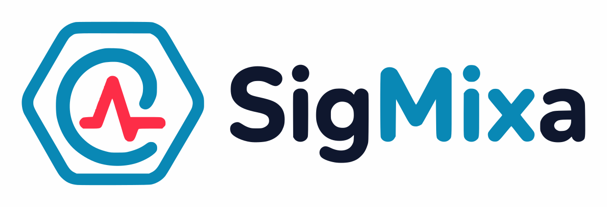
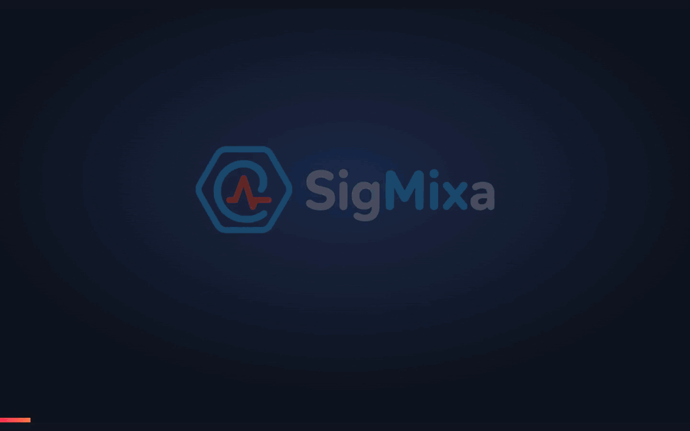
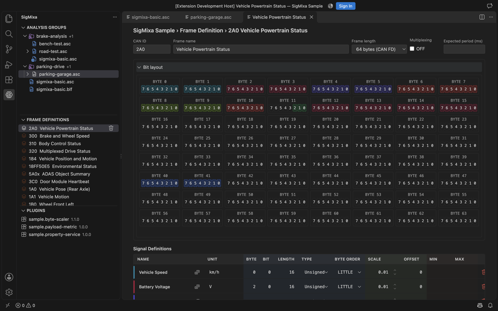
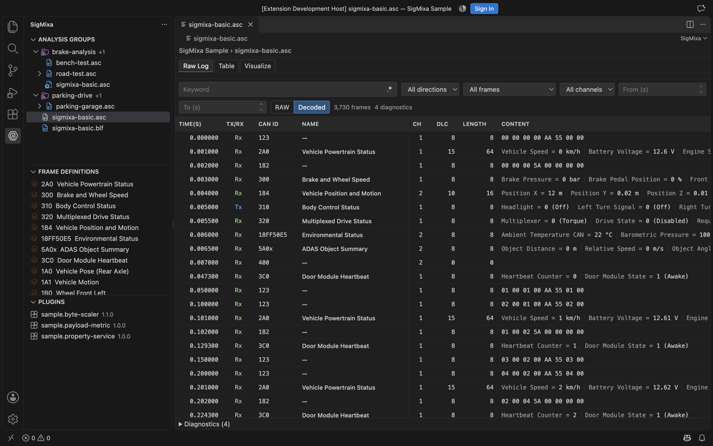
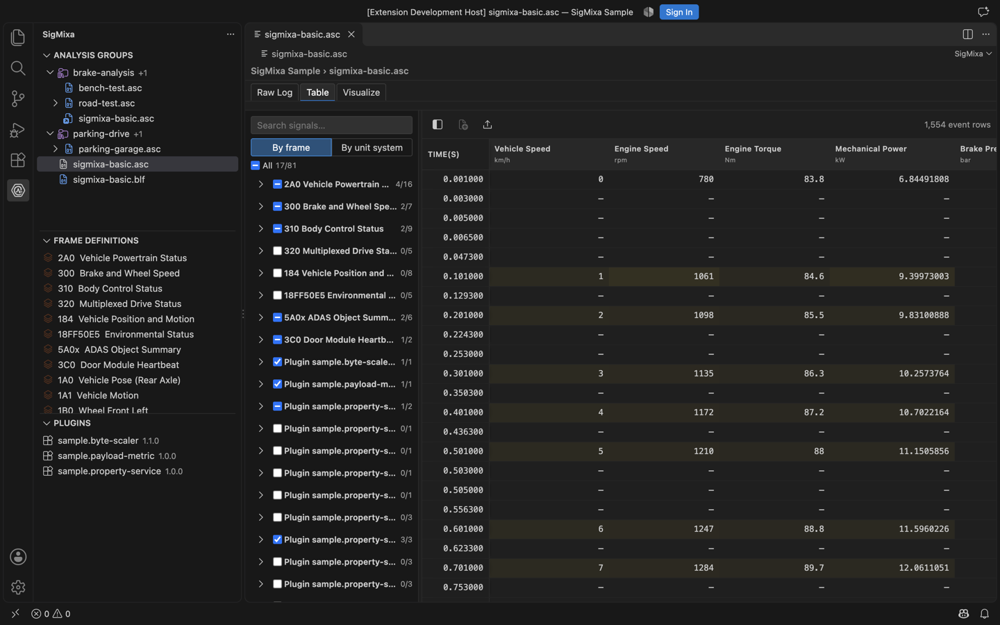
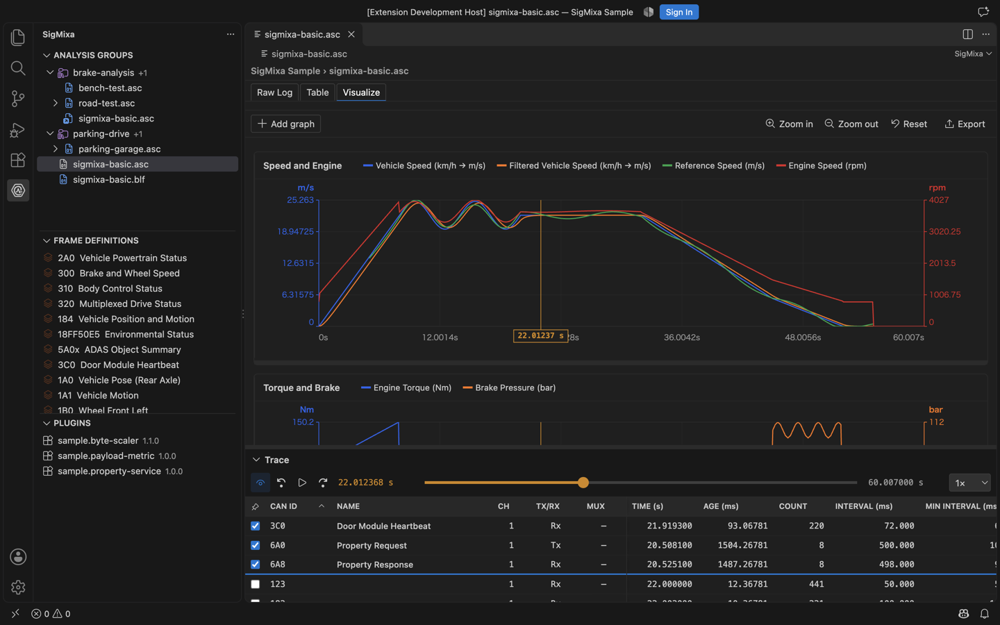
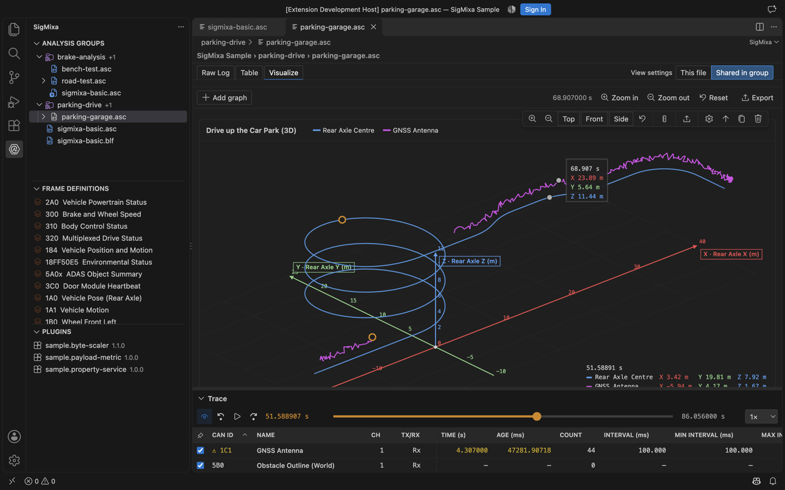
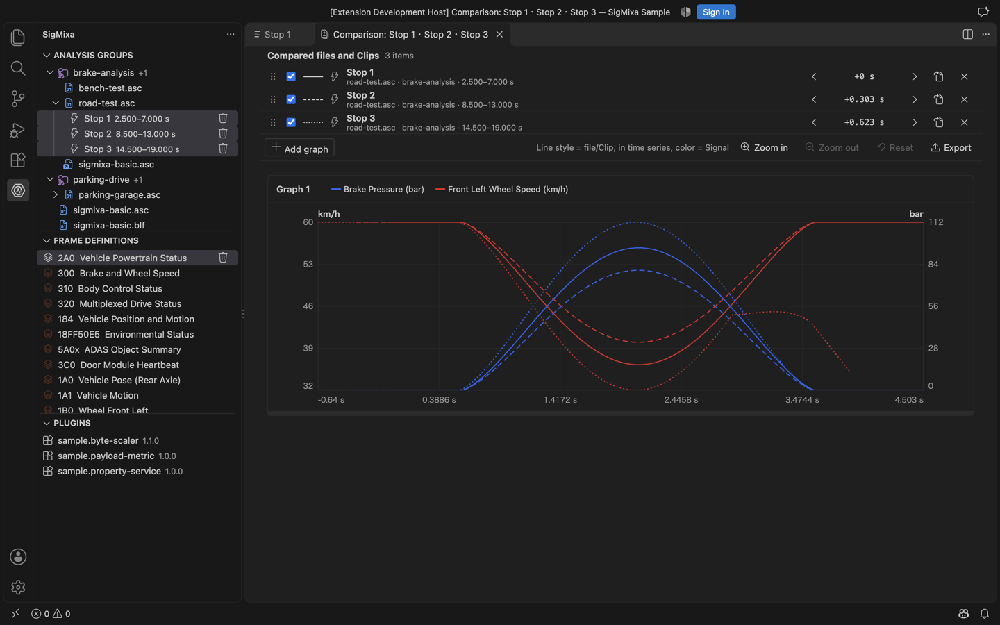

# SigMixa for VS Code

**Open-source CAN / CAN FD log analyzer that runs locally inside VS Code.**

Decode ASC or BLF captures with DBC, plot Signals, compare intervals across recordings and replay 2D/3D trajectories. SigMixa's built-in analysis runs offline and does not upload your captures.

[Watch the video](media/demo.mp4)

A free, open-source alternative for offline CAN log analysis.

## Features

- Import Vector ASC and BLF for Classic CAN and CAN FD, with progress, cancellation and diagnostics.
- Define Signals visually with Intel/Motorola byte order, signed values, Scale/Offset, value labels and Multiplexing; import or export DBC definitions.
- Create Derived Signals with expressions, linear interpolation, low-pass filters and moving averages.
- Inspect RAW Logs and Signal Tables with filtering, multi-row copy, VS Code text-editor integration and CSV export.
- Visualize any number of graphs and 2D/3D trajectories in one view, with unit conversion, pinned values and a trace of every CAN ID's latest values, intervals and expected periods.
- Manage logs per analysis with **analysis groups**: folders that share Frame definitions and view settings, overlaid on the workspace's definitions.
- Cut intervals out as Clips and compare logs and Clips side by side, shifting each target in time.
- Export views as SVG/PNG or as an interactive, offline HTML report.
- Extend decoding through local Plugins, including stateful ones, with schema-generated settings.
- Use English or Japanese UI according to your VS Code display language.

## See SigMixa in action

### Define Frames and Signals visually

Configure CAN IDs, frame lengths, bit layouts and Signal decoding rules in one editor, or import the definitions from DBC. Hover or edit a Signal to highlight its bits and MSB/LSB; click a bit to find its definition. Colors follow Signals when rows are reordered. Changes apply automatically. Scale selects arithmetic automatically: power-of-two magnitudes shift integer RAW, apply the Scale sign, then add Offset; other values such as `0.01` retain fractional values. Positive and negative Scale values are supported. Direct conversion uses integer/rational arithmetic before producing the result. Multiplexed Frames show per-Signal activation rules and a switchable bit-layout preview.

Expand a Derived Signal to edit its linear-interpolation table alongside the curve, or inspect a filter's example step response. Editing a table point highlights the matching curve point without reordering the input rows. Double-click a column boundary to fit its contents.

### Inspect and decode every frame

Filter Classic CAN and CAN FD Frames by keyword or regular expression, direction, channel and time. Switch CONTENT between RAW bytes and decoded Signals; undefined Frames retain their RAW payload. Select or drag across rows to copy into Excel or open them in a VS Code text editor.

### Compare decoded Signals as a table

Choose Signals by Frame and inspect their values at the original event timestamps. Reorder or resize columns, copy selected rows, or export the displayed Signals to CSV.

### Visualize graphs and trajectories together

**Visualize** stacks any number of graph and trajectory views that share one time position. Each graph converts compatible units onto one axis (for example km/h from CAN and m/s from a CSV file) and shows up to two unit systems on real-value axes. Hover or pin markers to inspect original samples; hover a legend entry to emphasize a Signal. **Connect gaps** joins samples taken at different periods without changing the measured values.

Trajectories draw X/Y and optional Z Signals in 2D or 3D, with several series in one view, such as the four wheels of a vehicle. Rotate, zoom, use Top/Front/Side presets, inspect points or measure between two points.

Below the views, the **trace** lists every CAN ID's latest values at the time position, with receive count, intervals and the deviation from an expected period. Play or step through time and every view follows. Export the views as SVG/PNG or as an HTML report.

### Analysis groups, Clips and comparison

An analysis group is a folder with a `.sigmixa` folder: it holds the Frame definitions and view settings for one analysis and applies them to every log in it, on top of the workspace's definitions. Add a log stored elsewhere to a group and it appears there as well as where it is, using the definitions of the place it is opened from. Copy a group's folder to share it.

When one recording holds several trials, cut each out as a Clip. Select logs and Clips in **ANALYSIS GROUPS** and compare them, shifting each one in time to line up events.

### Signal flow

In Frame Definition, use **Signal flow** beside a Derived Signal name. Only its upstream dependencies are shown. Select a node to focus its definition; unresolved inputs are marked rather than connected to an unrelated Signal.

## Getting started

1. Install **SigMixa** from the VS Code Marketplace. A downloaded VSIX can also be installed from **Extensions → … → Install from VSIX…**.
2. Open the folder containing your log files in VS Code.
3. Open the SigMixa icon in the Activity Bar.
4. In **ANALYSIS GROUPS**, use **Open CAN Log**, or select a log already in the folder.
5. Add or edit definitions under **FRAME DEFINITIONS**, then use RAW Log, Table and Visualize.

For a guided tour of each analysis view, see the [User Guide](docs/user-guide.md). To explore every main workflow with prepared data and settings, open the [sample workspace](sample).

Use the database button in **FRAME DEFINITIONS** to import `BO_`/`SG_` definitions from
a DBC file. The export button writes one selected Frame or all registered Frames
back to DBC. Existing CAN IDs are never overwritten without confirmation.

Settings are saved in `.sigmixa/project.json`: the workspace root's file holds the workspace's definitions, Plugin registrations, CSV sources, Clips and view settings, and each analysis group's folder has its own. Workspaces from SigMixa 1.x open as they are.

## CAN ID notation

- Standard IDs use hexadecimal text such as `123` or `7FF`.
- IDs longer than three hexadecimal digits are treated as extended automatically.
- Add `x` to a short ID when it must be treated as extended, for example `5A0x`.

## Plugins

Use **PLUGINS → +** to select a Plugin package directory. Open a registered Plugin to enable or disable it, manage Frame bindings, edit its settings, reload it or unregister it.

Plugin authors can use the [SigMixa Plugin SDK](docs/plugin-sdk.md). Plugins are local executable code, so install only packages you trust.

## Sample workspace

Open the [`sample`](sample) directory as a VS Code workspace. `sigmixa-basic.asc` (or `.blf`) shows the basic features: decoding, Plugins, External CSV, time series and the trace. `brake-analysis/` shows analysis groups and Clips, and `parking-drive/` shows 3D and 2D trajectories. See the [sample guide](sample/README.md).

## Compatibility notes

- External CSV Signals are available in graphs, but are not merged into the event-row Table.
- Trajectory axes must come from one source and have exactly matching timestamps.
- Plugin configuration uses SigMixa's standard schema editor; Plugin-specific custom views are not supported.
- DBC Signal value labels (`VAL_`) are imported and exported. Edit them from the value-label button beside a Signal name; labels match RAW integers before Scale/Offset. RAW Log, Table and chart markers show the label alongside the numeric value. CSV exports remain numeric.
- DBC Frame/Signal definitions, Intel/Motorola byte order, signedness, Scale/Offset, limits, units, standard/extended IDs, Multiplexing and direct value labels are supported. DBC-only metadata such as comments, attributes and reusable named value tables (`VAL_TABLE_`) is not retained. Derived Signal operations cannot be represented in standard DBC and are reported during export.

## License

SigMixa, including its original logo and icon assets, is available under the
[MIT License](LICENSE). See [Third-Party Notices](THIRD_PARTY_NOTICES.md) for
third-party components.
